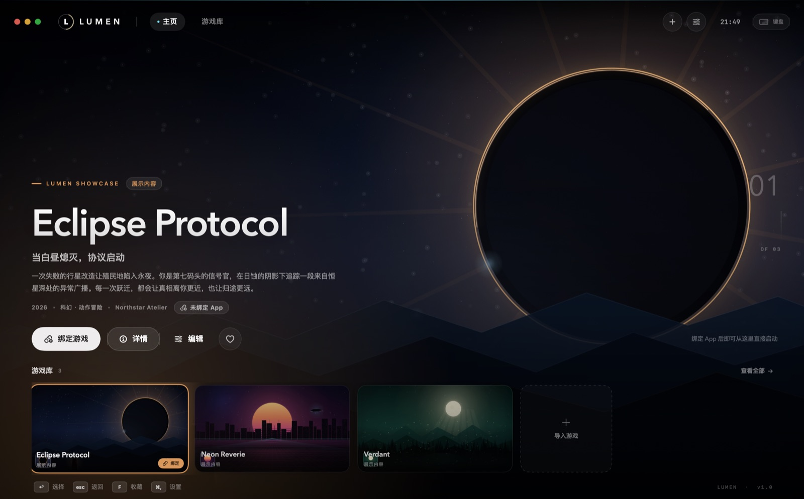
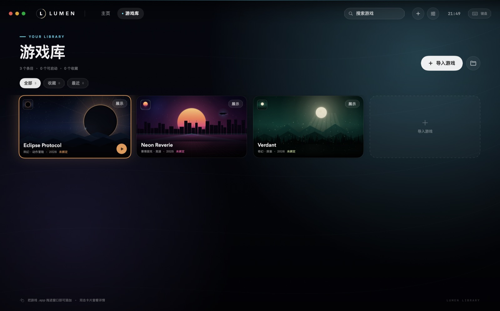
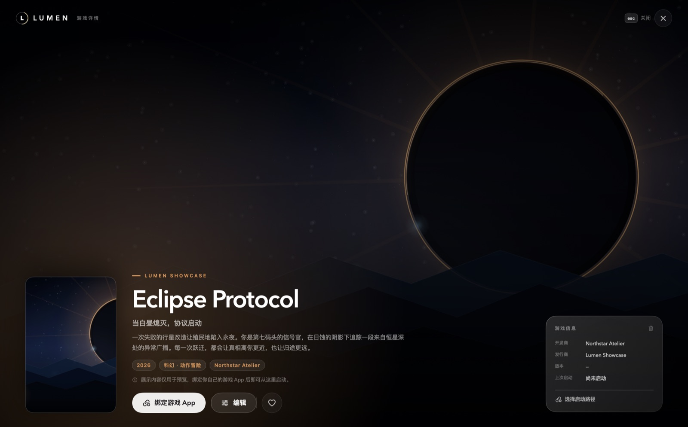
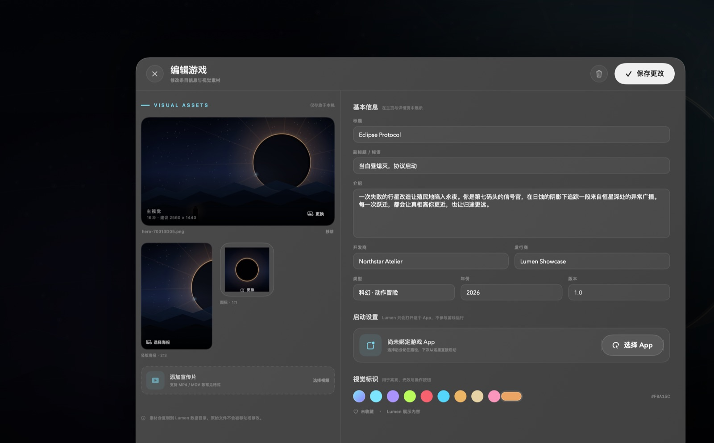
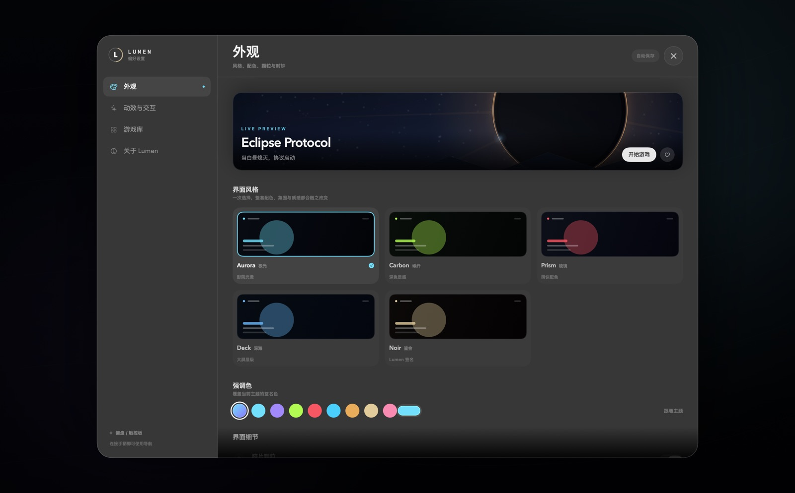

# Lumen

> 把游戏收进一束光里。

Lumen 是一个用 Swift + SwiftUI 编写的 macOS 游戏启动前端。它只负责「找到游戏、展示游戏、启动游戏」——
不注入进程、不接管画面、不修改任何游戏文件。游戏本身仍然由系统正常启动。

界面以 PlayStation 5 的影院式主页为起点，融合 Xbox 的深色质感、Nintendo Switch 的明快配色与
Steam 大屏幕的实用信息层级，并加入手柄导航、主题切换与界面动效。

> Lumen 是独立项目，与 Sony、Microsoft、Nintendo、Valve 均无关联，也未使用上述平台的商标或素材。



## 预览

| 游戏库 | 游戏详情 |
| --- | --- |
|  |  |

| 游戏编辑器 | 偏好设置 |
| --- | --- |
|  |  |

## 功能

- **影院式主页**：全幅主视觉、缓慢 Ken Burns 动效、游戏色调光晕、索引轨与电影感渐变。
- **本地游戏库**：网格布局、搜索、收藏 / 最近筛选、右键菜单、双击查看详情。
- **导入任意 macOS 游戏**：选择或拖入 `.app`；自动读取名称、版本、开发商、图标，其余信息可完全自定义。
- **完整的游戏资料**：标题、标语、介绍、开发商、发行商、类型、年份、版本、强调色。
- **视觉素材**：16:9 主视觉、2:3 竖版海报、1:1 图标、MP4 / MOV 宣传片；素材会复制到 Lumen 数据目录，原文件不被移动或修改。
- **导入校验**：检查 App Bundle 的 `Info.plist`、Bundle ID 与可执行文件；宣传片会校验轨道、时长与可播放性。
- **分片 MP4 自动修复**：检测 Bilibili DASH 等含 `moof` / `mvex` 的分片视频，提示并自动重封装为系统可完整播放的标准 MP4。
- **五种界面风格**：Aurora / Carbon / Prism / Deck / Noir，可在设置中即时切换；支持自定义强调色、胶片颗粒、环境光强度、时钟与动效开关。
- **启动即全屏**：默认以全屏进入大屏模式，可在「设置 → 动效与交互」关闭，下次启动生效。
- **闲置轮播**：主界面无操作后进入只浏览、不启动游戏的展示轮播；默认 5 分钟，可在「设置 → 动效与交互」选择其他档位或关闭。
- **手柄操作**：支持标准 `GameController` 手柄，主页、游戏库、详情页均可导航。
- **键盘操作**：方向键、回车、Esc、Tab 与常用快捷键。
- **完全离线**：无账号、无网络请求、无遥测；所有资料保存在本机。
- **首次运行的展示内容**：内置三款虚构游戏（Eclipse Protocol / Neon Reverie / Verdant）作为界面示例，可随时在设置中清除。

## 环境要求

- macOS 14 Sonoma 或更高版本
- Xcode 16 或更高版本（项目使用 Xcode 的新式文件系统同步分组）
- Apple Silicon 或 Intel Mac（源码构建）
- 无第三方运行时依赖

## 下载

前往 [GitHub Releases](https://github.com/ThecangShengdance/Lumen/releases) 查看可用的预编译包；
当前源码版本为 `1.0.2`。若还没有对应版本的可执行文件，请按下方「构建」从源码生成。预编译包为
Apple Silicon（arm64）版本，Intel Mac 请从源码构建。

首次打开若被 macOS 拦截，请前往「系统设置 → 隐私与安全性」选择「仍要打开」。应用使用 ad-hoc
签名、未经过 Apple 公证。

## 运行

1. 用 Xcode 打开 `Lumen.xcodeproj`。
2. 选择 `Lumen` scheme 与 `My Mac`，按 `⌘R`。

也可以在终端构建：

```bash
./scripts/build.sh
open build/Build/Products/Debug/Lumen.app
```

`scripts/build.sh` 默认构建 Debug；传入 `Release` 可构建发布版：

```bash
./scripts/build.sh Release
```

构建并直接打开：

```bash
./scripts/run.sh
```

生成可分发压缩包（Release + ad-hoc 签名，输出到 `dist/`）：

```bash
./scripts/package.sh
```

> 项目使用手动 ad-hoc 签名（`CODE_SIGN_IDENTITY = "-"`）且关闭 App Sandbox。
> 这是刻意为之：Lumen 需要调用 `NSWorkspace` 启动用户自己选择的任意 `.app`。
> Lumen 自身不包含网络权限，也不会读取游戏内部数据。

### 分发

构建产物不会纳入版本库（见 `.gitignore`）。需要发布时运行 `./scripts/package.sh`，
再把生成的 `dist/Lumen-<version>.zip` 上传到 GitHub Releases。正式下载入口见上方「下载」。

## 添加游戏

1. 点击主页 / 游戏库右上角的 `+`，按 `⌘O`，或直接把 `.app` 拖进窗口。
2. 在弹出的编辑器中选择游戏 App。Lumen 会自动补全标题、开发商、版本与图标。
3. 按需添加主视觉、海报、图标与宣传片，填写介绍、类型、年份等信息。
4. 点击「添加到游戏库」。之后在主页按 `开始游戏` 即可启动。

展示内容（Showcase）没有绑定 App，点击「绑定游戏」会直接打开同一个编辑器；绑定后它会变成你的游戏条目。

## 操作

### 键盘

| 按键 | 功能 |
| --- | --- |
| `↑` `↓` `←` `→` | 移动焦点 / 切换游戏 |
| `Return` / `Space` | 确认 / 启动 |
| `Esc` | 返回 / 关闭 |
| `Tab` / `Shift+Tab` | 切换主页与游戏库 |
| `⌘1` / `⌘2` | 主页 / 游戏库 |
| `⌘F` | 打开游戏库并聚焦搜索 |
| `⌘O` | 导入游戏 |
| `⌘,` | 偏好设置 |
| `F` / `Y` | 收藏 / 取消收藏 |
| `X` | 编辑当前游戏 |
| `M` | 打开设置；详情页播放宣传片 |
| `E` | 编辑当前游戏（详情页 / 游戏库） |

### 手柄

| 按键 | 功能 |
| --- | --- |
| 左摇杆 / 十字键 | 移动焦点 |
| `A` | 确认 / 启动 |
| `B` | 返回 / 关闭 |
| `X` | 编辑当前游戏 |
| `Y` | 收藏 / 取消收藏 |
| `LB` / `RB` | 切换主页与游戏库 |
| `Menu` | 主页打开设置；详情页播放宣传片 |

手柄导航覆盖主页、游戏库与详情页；编辑器与设置页目前以键盘 / 鼠标输入为主。

## 主题与个性化

在「设置 → 外观」中：

- 选择五种风格之一，整套背景、强调色、质感与卡片气质会一起变化。
- 使用 8 个预设色或系统取色器覆盖强调色。
- 单独控制胶片颗粒、时钟、动效、手柄震动与环境光强度。

主题选择会保存在本地，并在下次启动时恢复。

## 数据位置

所有数据都在：

```text
~/Library/Application Support/Lumen/
├── library.json          # 游戏库与设置
└── Media/<游戏 UUID>/    # 导入的主视觉、海报、图标、宣传片
```

游戏 App 本身不会被复制或移动。删除 Lumen 数据目录即可恢复初始状态（会重新生成三款展示内容）。

开发与自动化测试时可用 `LUMEN_SUPPORT_DIR` 指向独立目录，避免污染真实游戏库。

## 项目结构

```text
Lumen/
├── Lumen.xcodeproj
├── Lumen/
│   ├── App/              # 入口、根视图、启动动画、离屏渲染调试工具
│   ├── Core/             # 数据模型、持久化、媒体管理、手柄桥接
│   ├── Design/           # 主题、字体、玻璃材质、通用组件
│   ├── Views/            # 主页、游戏库、详情、编辑器、设置、文件面板
│   ├── Resources/        # 三款展示内容的生成主视觉与图标
│   └── Assets.xcassets/  # App 图标
├── scripts/
│   ├── build.sh          # 命令行构建
│   ├── run.sh            # 构建并打开
│   ├── package.sh        # Release + zip
│   └── generate_art.swift# 生成展示内容与 App 图标
├── screenshots/
└── README.md
```

### 设计说明

- `AppModel` 是唯一状态源，负责持久化、焦点、导航、启动与手柄语义动作。
- `AmbientBackground` / `GlassPanel` / `LumenFont` 构成统一视觉层；五种主题只改变调色板与质感，不复制界面。
- 启动游戏使用 `NSWorkspace.OpenConfiguration`，成功后才更新「上次启动」与启动次数。
- `GamepadManager` 只把 `GameController` 输入翻译为语义动作，不接触游戏进程。
- 展示内容与图标由 `scripts/generate_art.swift` 以 Core Graphics 生成，不依赖外部图片素材。

### 调试截图

Debug 构建支持离屏渲染，便于在锁屏或无显示器环境中检查界面：

```bash
./build/Build/Products/Debug/Lumen.app/Contents/MacOS/Lumen \
  --no-boot --library \
  --render /tmp/lumen-library.png \
  --render-size 1480x920
```

可用路由：`--library`、`--detail`、`--settings`、`--editor`、`--new-editor`、`--theme carbon`、`--accent "#B7FF4C"`。
这些参数只在 Debug 构建中生效。

## 已知限制

- 仅支持 macOS；启动方式遵循系统 `NSWorkspace`，不提供启动参数、兼容层或反作弊适配。
- 宣传片使用 `AVPlayerView` 播放，能否播放取决于系统解码器与视频封装格式。
- 手柄导航暂未覆盖编辑器和设置页的全部控件。
- 这是本地开发构建，未做 Apple Developer ID 签名与公证；分发给其他 Mac 时需要进行签名与公证。

## 贡献

欢迎提交 Issue 和 Pull Request。提交前请确认 `./scripts/build.sh` 能通过，并尽量保持现有的
`AppModel` 单一状态源与主题层结构。

## 素材说明

三款展示游戏、其名称、文案与主视觉均为本项目创作的虚构内容，不包含任何第三方游戏素材。
App 图标与展示主视觉由仓库内的 Swift 脚本生成，可自由修改后重新生成。

## 许可证

本项目采用 [MIT License](LICENSE) 开源。
